# Windows Modern for KDE Plasma 6

A complete Windows 11-inspired visual transformation for KDE Plasma 6.

Windows Modern includes matching window decorations, widget styles, color schemes, Plasma desktop themes, global themes, an icon pack, custom applets, a panel layout template, and wallpapers — all available in **dark** and **light** variants.

> **Note:** This theme is designed for **KDE Plasma 6**. It will not work on Plasma 5.

## Screenshots

| Dark | Light |
|:---:|:---:|
| 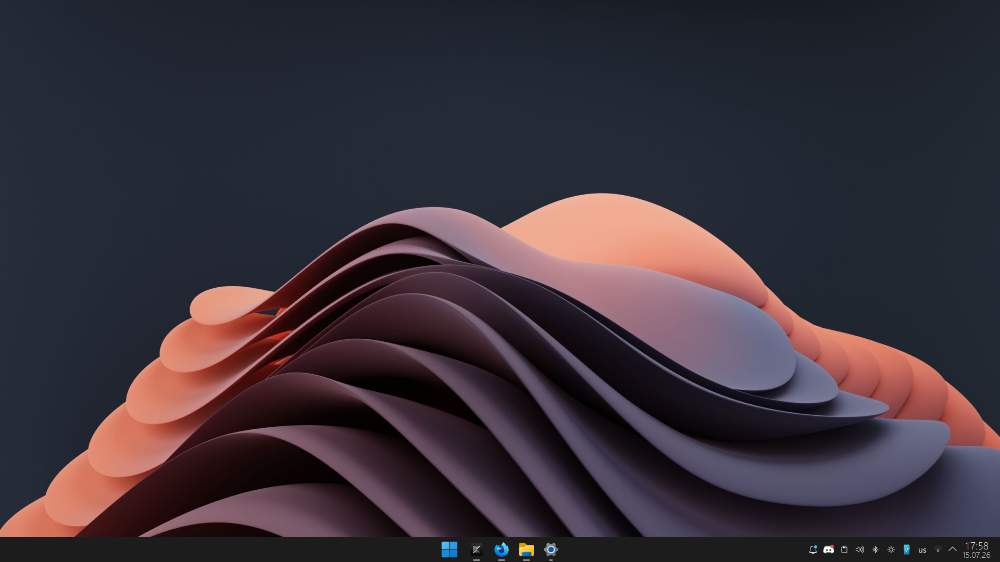 | 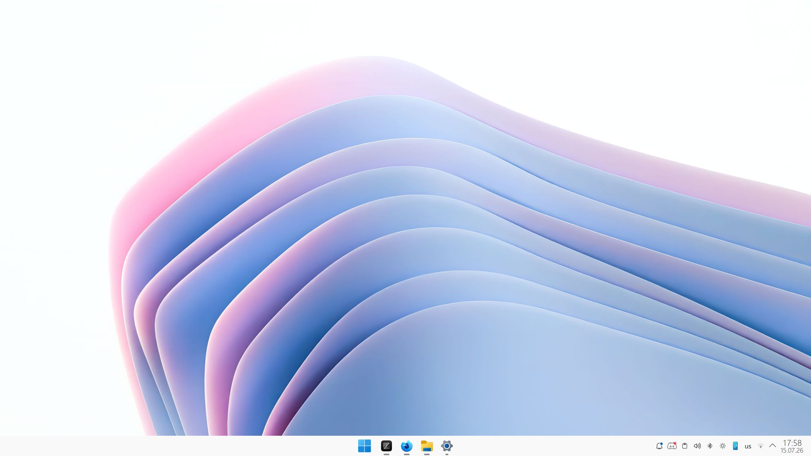 |
| *Desktop overview* | *Desktop overview* |
| 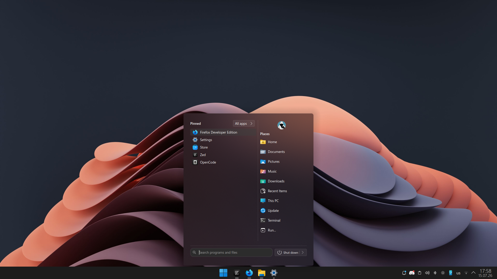 | 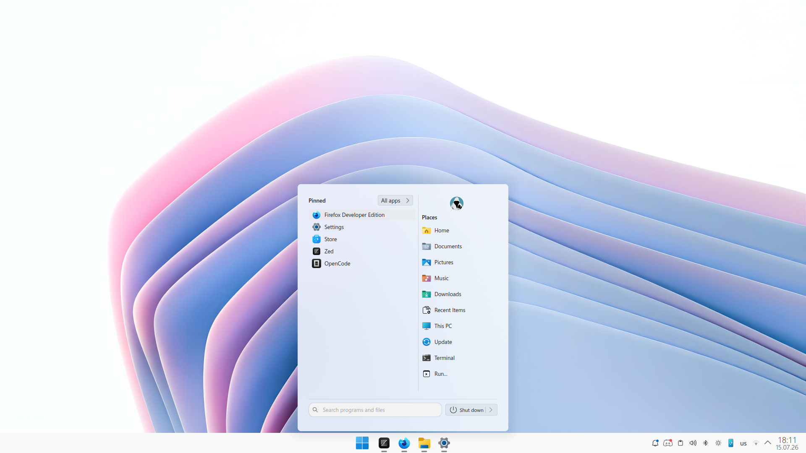 |
| *Start Menu — Pinned apps* | *Start Menu — Pinned apps* |
| 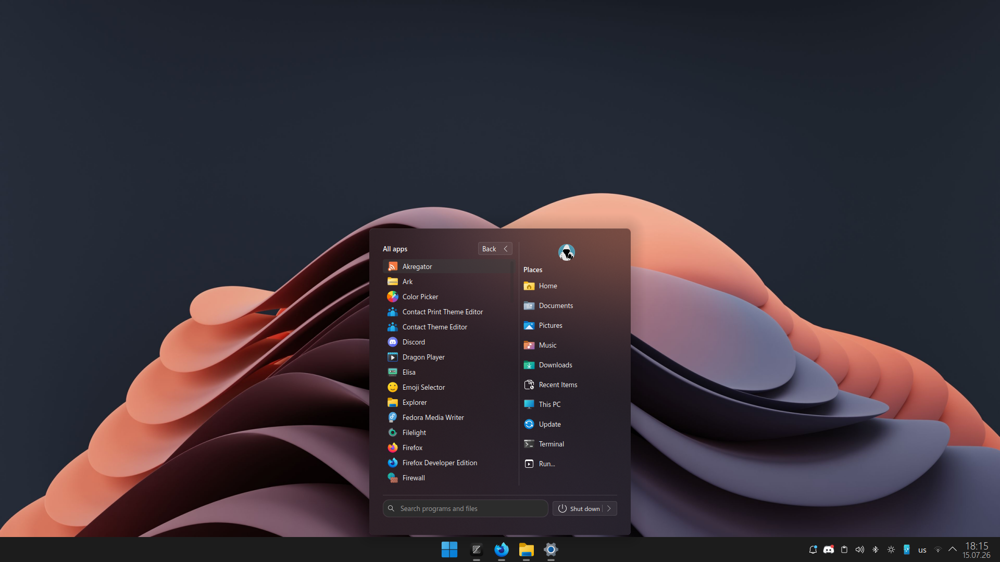 |  |
| *Start Menu — All Apps* | *Start Menu — All Apps* |
| 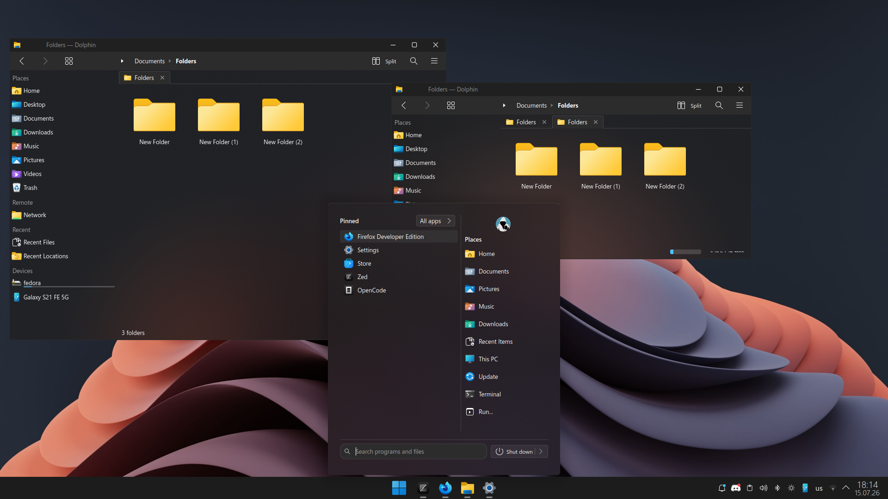 | 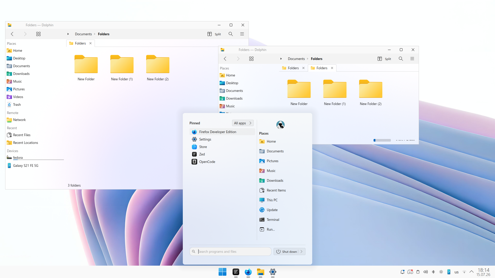 |
| *Start Menu with windows* | *Start Menu with windows* |
| 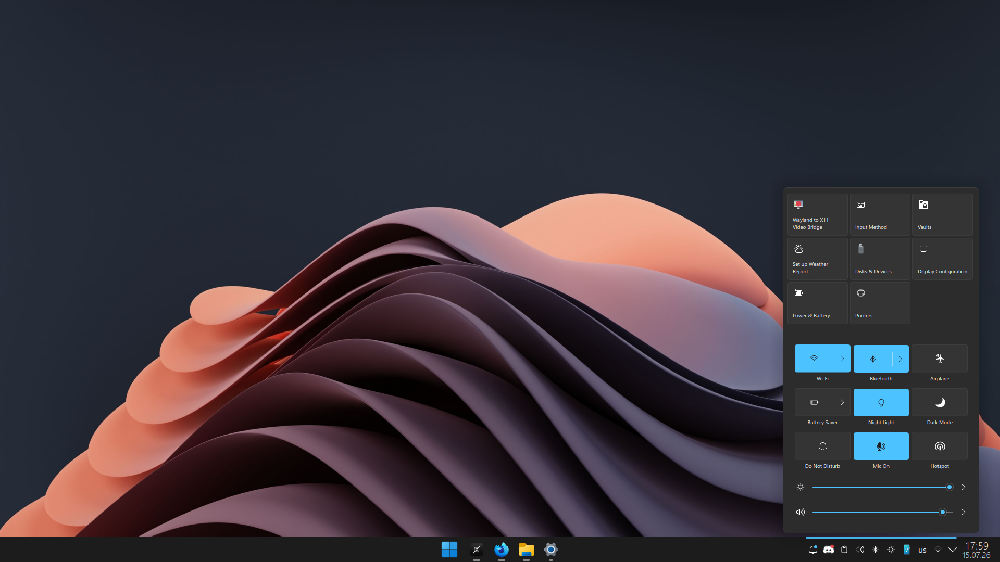 | 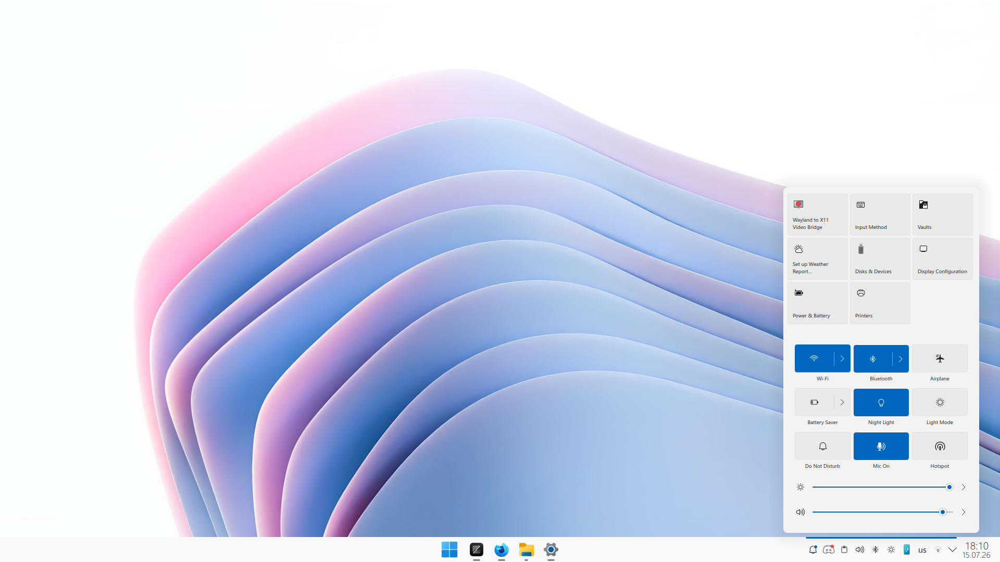 |
| *Quick Settings flyout* | *Quick Settings flyout* |
| 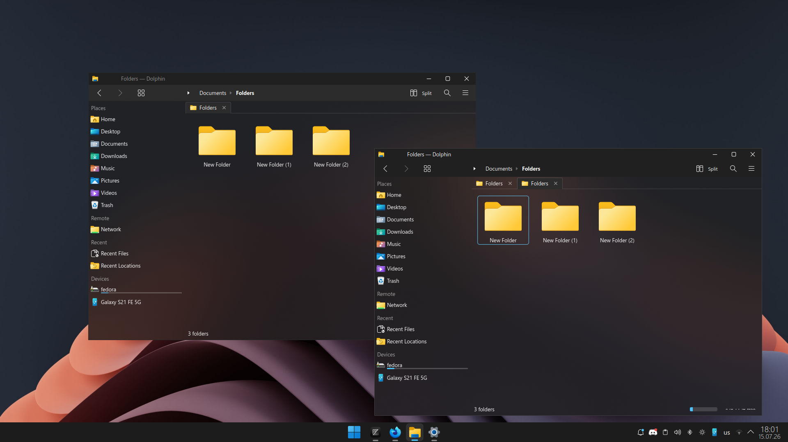 | 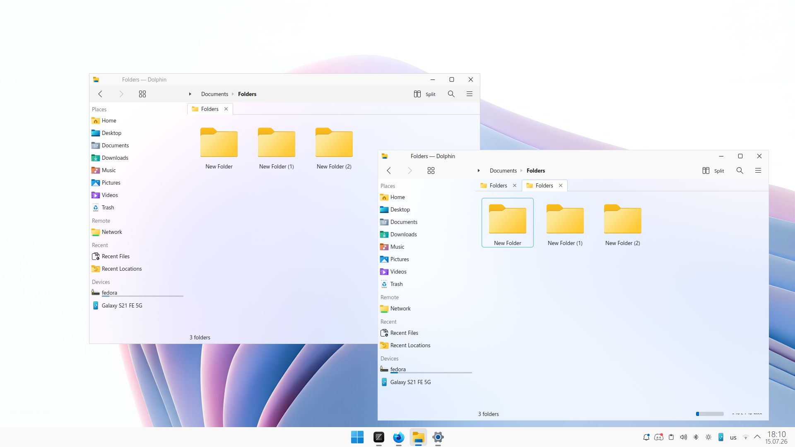 |
| *Window decorations* | *Window decorations* |

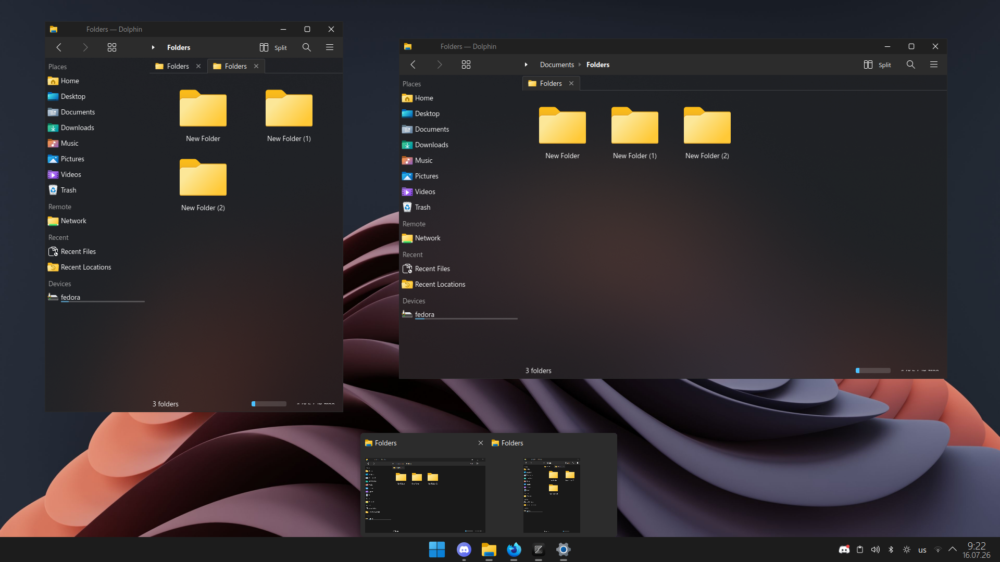
*Icon taskbar — hovering an icon on the icons-only taskbar reveals a Win11-style thumbnail tooltip with a per-tile close button. Dark variant shown.*

---

## What's included

| Component | Path | Description |
|-----------|------|-------------|
| **Aurorae window decorations** | `aurorae/` | Dark and light title bars with Win11-style caption buttons. |
| **Kvantum widget style** | `Kvantum/` | `Windows-modern` — ships both light and dark variants; KDE switches between them via `kvantum`/`kvantum-dark`. |
| **Plasma color schemes** | `color-schemes/` | `WindowsModernDark.colors`, `WindowsModernLight.colors`. |
| **Plasma desktop themes** | `plasma/desktoptheme/` | Full SVG theme sets for panels, widgets, tooltips, dialogs, switches, and tasks. |
| **Global themes** | `plasma/look-and-feel/` | `org.kde.windowsmodern.dark` and `org.kde.windowsmodern.light`. |
| **Panel layout template** | `plasma/layout-templates/` | A Win11-style bottom panel layout you can add from the desktop context menu. |
| **Custom applets** | `plasma/applets/` | Show Desktop, Start Menu, Digital Clock, C++ System Tray, and C++ Icon Tasks (icons-only taskbar). |
| **Alt+Tab switcher** | `plasma/windowswitcher/` | Windows 11-style window switcher: aspect-correct previews in centered rows, follows the dark/light colour scheme. |
| **Session lock screen** | `plasma/shells/org.kde.windowsmodern.lockscreen/` | Win11-style lock screen for Meta+L (kscreenlocker). Installed as a complete overlay of the default desktop shell. |
| **Boot greeter** | `plasma/look-and-feel/.../contents/lockscreen/` + `third_party/plasma-login-manager/` | Patched Plasma Login Manager build that loads a Win11 login screen. Opt-in (system install needs root). |
| **Icon pack** | `icons/windows-modern/` | Curated Windows-11-style icon theme (~25,000 SVGs). |
| **Wallpapers** | `wallpaper/` | Dark and light variants. |
| **App decorations** | `app-decorations/` | Per-app CSD tweaks so non-KDE apps match the theme. Currently: Firefox `userChrome.css` window controls. |

---

## Requirements

- **KDE Plasma 6**
- **Kvantum** engine installed (`kvantum` package on most distros)
- For the **System Tray and Icon Tasks applets**: nothing extra when you
  install from a release on a supported Fedora (prebuilt plugins are
  downloaded); otherwise
- For the **System Tray applet**: a C++ compiler and KDE/Plasma development packages (see [System Tray](#system-tray) below)
- For the **Icon Tasks applet**: a C++ compiler and a slightly different KDE/Plasma dev set (see [Icon Tasks](#icon-tasks) below)
- For the **Digital Clock applet**: no extra deps (pure QML).
- For the **session lock screen**: no extra deps (pure QML, installed as a shell overlay).
- For the **boot greeter**: a C++ compiler and the Plasma Login Manager build deps (Qt6 ShaderTools, LayerShellQt, libkscreen, PAM) — see [`plasma/look-and-feel/org.kde.windowsmodern.dark/BUILD.md`](plasma/look-and-feel/org.kde.windowsmodern.dark/BUILD.md).

---

## Installation

### Quick start (also: setting up a new machine)

```bash
git clone https://github.com/Jeysef/KDE-Windows-Modern && cd KDE-Windows-Modern
./install.sh
```

Opens a menu (default choice = **Everything**). Pick **1** and you'll be
asked only one question: **Light or Dark?** Everything else is set up
for you, in this order:

1. **Dependencies:** Kvantum, Flatpak, and the build tools for the two
   C++ applets (only what's missing; one password prompt).
2. **Look:** themes, icons, applets, layout, KWin borders, per-monitor
   Alt+Tab, Application Style, wallpaper, panel layout reset.
3. **Behaviour:** Windows keyboard shortcuts, Snap Layouts, the everyday
   apps (Haruna, KWrite, Mission Center) with Snipping Tool–style
   screenshots, and Windows fonts (Segoe UI or Selawik, Cascadia Mono).

On a fresh Plasma install this one run is all you need. Run it from
your normal account (it asks for the password itself when needed) and
inside a Plasma session, since shortcuts are applied to the running
session.

### Install everything non-interactively

```bash
./install.sh all              # asks Light/Dark if run in a terminal
./install.sh all --dark       # no prompts, Dark
./install.sh all --light      # no prompts, Light
```

`all` installs in four phases: **atomic pieces** (dependencies, themes,
icons, applets, session lock) → **compose** (layout template,
look-and-feel) → **apply once** (KWin tweaks, global theme with layout
reset, Kvantum engine, single Plasma Shell restart) → **behaviour**
(shortcuts, apps).

> `all` includes the session lock screen (Meta+L). The boot greeter is
> **opt-in** (it replaces the system login manager) — use
> `./install.sh greeter`.

### Install individual components

Each component installs **and applies immediately** — no extra steps
needed (Plasma Shell restarts automatically where required).

```bash
./install.sh themes       # Aurorae, colors, Kvantum, Plasma, wallpapers (+ applies)
./install.sh icons        # Icon pack (+ activates)
./install.sh lookfeel     # Global themes (asks Light/Dark, applies with layout reset)
./install.sh layout       # Panel layout template
./install.sh showdesk     # Show Desktop applet (+ restarts shell)
./install.sh startmenu    # Start Menu applet (+ restarts shell)
./install.sh systray      # System Tray (C++ — see below)
./install.sh icontasks    # Icon Tasks taskbar (C++ — see below)
./install.sh digitalclock # Digital Clock (+ restarts shell)
./install.sh applets      # All five applets (single restart)
./install.sh sessionlock  # Session lock screen (Meta+L)
./install.sh alttab       # Windows 11-style Alt+Tab switcher
./install.sh shortcuts    # Windows keyboard shortcuts (see below)
./install.sh apps         # Haruna, KWrite, Mission Center, Snipping Tool behaviour
./install.sh fonts        # Segoe UI or Selawik, Cascadia Mono
./install.sh deps         # Dependencies only
./install.sh greeter      # Boot greeter (PLM build + system install)
```

---

## After installing

For `all` / menu **Everything**, the only manual step is:

- **Enable floating** for the authentic Win11 look:
  Right-click the panel → **Show Panel Configuration → Floating → Applets Only**.
  (Plasma's scripting API can't set this automatically.)

That's it — global theme, colors, icons, Application Style (Kvantum),
wallpaper, and panel layout are all applied for you.

---

## Windows keyboard shortcuts

`./install.sh shortcuts` makes the Windows keys do what your hands
expect. KDE already matches Windows for Win+E, Win+I, Win+L, Win+D,
Win+V, Win+., Win+P, Win+Shift+S, Win+Left/Right, Win+Ctrl+Left/Right,
Win+Space and Win+1…9; these are changed:

| Keys | Now does (as on Windows) | KDE's default was |
|---|---|---|
| Win+Up / Win+Down | Maximize · restore · minimize; on a snapped window, quarter snap | Snap to top/bottom half |
| Win+Tab | Task View (Overview) | Cycle windows |
| Win+R | Run (KRunner) | Record screen region |
| Win+A / Win+N | Quick Settings / notifications | Next Activity / – |
| Win+M · Win+Home | Minimize all (again: restore) · minimize all others | – |
| Win+PrtSc · Alt+PrtSc | Save a full screenshot silently · capture the active window | Active window · – |
| Ctrl+Shift+Esc | Mission Center (with `apps`) | System Monitor (if set) |

The same component adds **Snap Layouts**: drag a window towards the top
edge and a bar of layouts (halves, thirds, quarters…) appears at the top
centre; drop the window on a cell to snap it there. It also moves the
volume/brightness pop-up to just above the taskbar, where Windows 11 shows it.

Your previous keys are backed up to
`~/.local/share/windows-modern/backup/` and `./uninstall.sh shortcuts`
puts them back. Win+Up/Down come from a small KWin script
(`plasma/kwinscripts/org.kde.windowsmodern.snapkeys`).

## Apps

`./install.sh apps` sets up the everyday tools a Windows user reaches for:

| Windows | Here | Notes |
|---|---|---|
| Media Player | **Haruna** | Default for video files; Qt, so it follows the theme. |
| Notepad | **KWrite** | Installed; your default text editor is left alone. |
| Task Manager | **Mission Center** | From Flathub (per user), on Ctrl+Shift+Esc. GNOME-styled. |
| Snipping Tool | **Spectacle** | PrtSc / Win+Shift+S: select a region; on release it is copied and saved to Pictures/Screenshots. |
| File Explorer | **Dolphin** | Up button next to Back/Forward (only if you have no toolbar layout of your own). Win+E opens it. |

`./uninstall.sh apps` restores your previous defaults; the apps stay
installed.

## Fonts

`./install.sh fonts` uses Windows 11's fonts where it can:

- **UI:** Segoe UI if you have it (it can't be shipped). Otherwise
  Microsoft's open **Selawik** (same metrics) is downloaded and used
  wherever "Segoe UI" is asked for.
- **Monospace:** **Cascadia Mono**, from your distro.

Your fonts change only if they are still distro defaults;
`./uninstall.sh fonts` puts the previous ones back.

## Applets

### Show Desktop

A thin 6-pixel sliver at the far right of the panel. Click it to minimize or restore all windows.

### Start Menu

A Win11-style start menu with Pinned apps, All Apps, and Search pages.

- Install: `./install.sh startmenu`
- Add it to the panel and remove the default Plasma menu.
- Implementation plan: [`docs/STARTMENU_PLAN.md`](docs/STARTMENU_PLAN.md)

### Digital Clock

A pure-QML digital clock with a Windows 11 styled compact panel view and expanded calendar popup. It reuses the upstream Plasma clock and calendar backends but draws its own visuals: padded text in the panel, a dark rounded popup, a month calendar with the current day highlighted in blue, and optional event dots from KDE calendar plugins. It keeps all upstream settings (time format, date format, time zones, calendar plugins) while omitting pin-on-middle-click, calendar launch, clipboard copy, and wheel timezone switching.

- Install: `./install.sh digitalclock`
- The Windows Modern panel layout uses it automatically; it falls back to the upstream `org.kde.plasma.digitalclock` if the custom applet is not installed.

### System Tray

A full C++ fork of the upstream Plasma system tray, themed to match Windows 11 and integrated with quick settings (network, Bluetooth, volume, brightness, battery, clipboard, notifications, devices, and media player).

Because it is a compiled Plasma Containment, it must be built during installation.

#### Install build dependencies

**Fedora:**

```bash
sudo dnf install gcc-c++ cmake extra-cmake-modules \
  qt6-qtbase-devel qt6-qtdeclarative-devel \
  kf6-kpackage-devel kf6-kconfig-devel kf6-ki18n-devel kf6-kcoreaddons-devel \
  kf6-kwindowsystem-devel kf6-kio-devel kf6-kiconthemes-devel \
  kf6-kitemmodels-devel kf6-kservice-devel kf6-kxmlgui-devel \
  kf6-kjobwidgets-devel kf6-kcmutils-devel \
  libplasma-devel plasma-workspace-devel plasma-workspace-libs
```

**Arch Linux:**

```bash
sudo pacman -S cmake extra-cmake-modules qt6-base qt6-declarative \
  kpackage kconfig ki18n kwindowsystem kio kiconthemes \
  kitemmodels kservice kxmlgui kjobwidgets kcmutils \
  plasma-framework plasma-workspace dbusmenu-qt6
```

**Debian/Ubuntu:**

```bash
sudo apt install cmake extra-cmake-modules \
  qt6-base-dev qt6-declarative-dev \
  libkf6package-dev libkf6config-dev libkf6i18n-dev \
  libkf6windowsystem-dev libkf6kio-dev libkf6iconthemes-dev \
  libkf6itemmodels-dev libkf6service-dev libkf6xmlgui-dev \
  libkf6jobwidgets-dev libkf6kcmutils-dev \
  libplasma-dev plasma-workspace-dev \
  libdbusmenu-qt6-dev
```

#### Build and install

```bash
./install.sh systray
```

For development, use the applet's own script:

```bash
cd plasma/applets/org.kde.windowsmodern.systemtray
./dev.sh
```

Detailed build instructions: [`plasma/applets/org.kde.windowsmodern.systemtray/BUILD.md`](plasma/applets/org.kde.windowsmodern.systemtray/BUILD.md)

### Icon Tasks

A C++ fork of the upstream icons-only task manager (`org.kde.plasma.taskmanager` from plasma-desktop), restyled with Windows 11 tooltip visuals. It registers under the stock plugin ID `org.kde.plasma.icontasks`, so it replaces the icons-only task manager transparently; uninstalling restores the stock one. The C++ backend is preserved unchanged (jump lists, places, recent docs, app categories, smart launcher badges, audio stream matching); only the QML UI is restyled. This is the taskbar used by the Windows Modern panel layout template.

Win11 refinements over upstream:

- **Always icons-only** — `iconsOnly` is hardcoded to `true`.
- **Hidden subtext in thumbnail mode** — desktop/activity info ("On Desktop 2") is hidden when a window thumbnail is visible, since it's noise next to a live preview.
- **Subtle per-tile close button** — a minimal X pinned to the far right of the tooltip header. Background is transparent by default and turns Win11 red `#C42B1C` on hover; pressed is `#9E1B1B`.
- **Fixed-width, rounded thumbnail tiles** — PipeWire thumbnails are clipped to 8px rounded corners, tiles render at a fixed width, and inter-tile spacing matches the tooltip SVG margin for even gaps.

Because it is a compiled Plasma applet, it must be built during installation. The QML UI is embedded in the `.so`; a separate KPackage must **not** be installed — it causes rendering bugs.

#### Install build dependencies

The Icon Tasks dependency set differs slightly from the System Tray (it adds `plasma-activities`, `libksysguard`, and `knotifications`).

**Fedora:**

```bash
sudo dnf install gcc-c++ cmake extra-cmake-modules \
  qt6-qtbase-devel qt6-qtdeclarative-devel \
  kf6-kpackage-devel kf6-kconfig-devel kf6-ki18n-devel kf6-kcoreaddons-devel \
  kf6-kwindowsystem-devel kf6-kio-devel kf6-kservice-devel kf6-kxmlgui-devel \
  kf6-knotifications-devel \
  plasma-activities-devel plasma-activities-stats-devel \
  libplasma-devel plasma-workspace-devel \
  libksysguard-devel
```

**Arch Linux:**

```bash
sudo pacman -S cmake extra-cmake-modules qt6-base qt6-declarative \
  kpackage kconfig ki18n kwindowsystem kio kservice kxmlgui knotifications \
  plasma-activities plasma-activities-stats \
  plasma-framework plasma-workspace \
  libksysguard
```

**Debian/Ubuntu:**

```bash
sudo apt install cmake extra-cmake-modules \
  qt6-base-dev qt6-declarative-dev \
  libkf6package-dev libkf6config-dev libkf6i18n-dev \
  libkf6windowsystem-dev libkf6kio-dev libkf6service-dev libkf6xmlgui-dev \
  libkf6notifications-dev \
  libplasma-dev plasma-workspace-dev \
  plasma-activities-dev plasma-activities-stats-dev \
  libksysguard-dev
```

#### Build and install

```bash
./install.sh icontasks
```

For development, use the applet's own script:

```bash
cd plasma/applets/org.kde.windowsmodern.icontasks
./dev.sh
```

Detailed build instructions: [`plasma/applets/org.kde.windowsmodern.icontasks/BUILD.md`](plasma/applets/org.kde.windowsmodern.icontasks/BUILD.md)

---

## Alt+Tab

A Windows 11-style window switcher for KWin. Every preview has the same
height and keeps its window's shape, cards wrap into centered rows, and the
selected window gets a rounded focus ring. Hover a card for its close button;
click to switch; arrow keys move across and between rows. It follows the
active colour scheme, so it works in both variants.

```bash
./install.sh alttab       # install + select (included in 'all')
./uninstall.sh alttab     # back to KWin's default switcher
```

KWin caches the switcher once it has been shown, so after **updating** it,
log out and back in to see the new version.

Source: `plasma/windowswitcher/org.kde.windowsmodern.alttab/`. Preview and
test it without KWin: `tests/windowswitcher/preview.sh` and
`tests/windowswitcher/run-tests.sh`; test it inside your running KWin with
`tests/windowswitcher/e2e.py`.

---

## Lock screen and boot greeter

Two separate components cover the two places a Windows-style lock/login look
applies. Both reuse the Win11 dark palette (clock, power menu, password
field) documented in [`docs/STYLE.md`](docs/STYLE.md).

### Session lock screen (Meta+L)

A Win11-style lock screen for kscreenlocker. kscreenlocker loads the lock
screen from the **current desktop shell** (`org.kde.plasma.desktop`), so the
installer creates a complete user-level overlay of that shell — symlinking
every system directory except `lockscreen`, which is replaced with the
Windows Modern QML. The shell is always kept complete (an incomplete shell
triggers the Qt widget fallback).

```bash
./install.sh sessionlock          # install
/usr/libexec/kscreenlocker_greet --testing   # test without locking
./uninstall.sh sessionlock        # restore Breeze
```

Source: `plasma/shells/org.kde.windowsmodern.lockscreen/`.

### Boot greeter / login screen (Plasma Login Manager)

A patched build of [plasma-login-manager](https://invent.kde.org/plasma/plasma-login-manager)
(vendored as a git submodule at `third_party/plasma-login-manager/`) that
loads a Win11 login screen (`Main.qml`) from the dark look-and-feel's
`contents/lockscreen/`. A single patch
(`patches/main-cpp.patch`) redirects the greeter to our `Main.qml`.

Because this replaces the system login manager, it is **opt-in** and **not
included in `install.sh all`**.

```bash
# 1. Build the patched greeter + install theme for --test mode (user):
./install.sh greeter
third_party/plasma-login-manager/build-user/bin/plasma-login-greeter --test

# 2. Install as your actual boot greeter (needs root, typed confirmation).
#    Run it with sudo from your normal account: the build runs as you, and
#    only the final copy into /usr runs as root.
sudo bash scripts/install-greeter-live.sh

# Maintainers: move the PLM submodule to a new upstream release
# (release branches Plasma/6.N or tags vX.Y.Z only), then commit the pointer:
./scripts/update-plm.sh Plasma/6.8
```

Local edits inside `third_party/plasma-login-manager/` are never discarded:
the build stashes them (`git -C third_party/plasma-login-manager stash pop`
restores them).

Keep a TTY (Ctrl+Alt+F3) open before the live install. Revert:

```bash
sudo bash scripts/uninstall-greeter-system.sh   # restore distro greeter
./uninstall.sh greeter                          # remove user theme + revert patches
```

Build dependencies differ slightly from the applets (PLM adds Qt6 ShaderTools,
LayerShellQt, libkscreen, and PAM). Full per-distro lists:
[`plasma/look-and-feel/org.kde.windowsmodern.dark/BUILD.md`](plasma/look-and-feel/org.kde.windowsmodern.dark/BUILD.md).

---

## App decorations

Optional per-app stylesheets that make non-KDE apps blend in with the Windows Modern title bar. These are not applied by the installer — copy them into the app's config manually.

### Firefox

Replaces Firefox's CSD window buttons (minimize / maximize / restore / close) with flat white MDL2 SVGs and the Windows close-hover color (`#c42b1c`). Button size matches Aurorae metrics (46×30).

- Copy [`app-decorations/firefox/userChrome.css`](app-decorations/firefox/userChrome.css) into your Firefox profile's `chrome/` folder.
- In `about:config`, set `toolkit.legacyUserProfileCustomizations.stylesheets` to `true`, then fully restart Firefox.

Full instructions: [`app-decorations/firefox/README.md`](app-decorations/firefox/README.md)

---

## Uninstall and verify

```bash
./uninstall.sh all           # Remove everything
./uninstall.sh themes        # Remove theme components only
./uninstall.sh icons         # Remove icon pack
./uninstall.sh lookfeel      # Remove global themes
./uninstall.sh layout        # Remove panel layout template
./uninstall.sh showdesk      # Remove Show Desktop applet
./uninstall.sh startmenu     # Remove Start Menu applet
./uninstall.sh systray       # Remove system tray plugin
./uninstall.sh icontasks     # Remove Icon Tasks, restore the stock icons-only task manager
./uninstall.sh digitalclock  # Remove Digital Clock applet
./uninstall.sh sessionlock   # Restore Breeze lock screen (Meta+L)
./uninstall.sh alttab        # Restore KWin's default Alt+Tab switcher
./uninstall.sh shortcuts     # Put your previous keyboard shortcuts back
./uninstall.sh apps          # Restore previous app defaults (apps stay installed)
./uninstall.sh fonts         # Restore previous UI and monospace fonts
./uninstall.sh greeter       # Remove user greeter theme + revert patches
./uninstall.sh greetersystem # Restore system greeter binary (needs sudo)
```

Run a health check:

```bash
./verify-all.sh              # Repository checks (also the release gate and CI)
./verify-all.sh --installed  # ...plus the installed System Tray and Icon Tasks plugins
```

---

## Development and contributing

See [`CONTRIBUTING.md`](CONTRIBUTING.md) for the development workflow,
the checks CI runs, and commit conventions. In short:

```bash
./verify-all.sh            # repository health check (what CI and release.sh run)
./scripts/ci-build.sh      # compile both C++ applets and check they link
```

### Committing icon pack changes

The `icons/windows-modern/` directory contains thousands of SVGs. To keep `git status` fast, those files are marked with `--skip-worktree` and `icons/**` is treated as binary in `.gitattributes`.

Never stage icon changes manually. Use the helper script:

```bash
COMMIT_MSG="feat(icons): describe your change" ./scripts/commit-icons.sh
```

The script temporarily re-enables tracking, stages the icon pack, commits with your message, then re-applies `--skip-worktree`.

### Building the System Tray locally

See [`plasma/applets/org.kde.windowsmodern.systemtray/BUILD.md`](plasma/applets/org.kde.windowsmodern.systemtray/BUILD.md) for the full manual build steps and distribution notes.

### Capturing README screenshots

```bash
./scripts/capture-screenshots.sh
```

Walks you through each desktop state (dark/light overview, start menu, system tray, window decorations) and captures optimized PNGs.

---

## Documentation

| Document | Description |
|----------|-------------|
| [`PRODUCT.md`](PRODUCT.md) | What the project is for, what's in scope, what's deliberately left out, and the roadmap. |
| [`CONTRIBUTING.md`](CONTRIBUTING.md) | Development workflow, checks, and commit conventions. |
| [`CHANGELOG.md`](CHANGELOG.md) | Notable changes per release. |
| [`docs/STYLE.md`](docs/STYLE.md) | Complete visual style specification: palette, desktop theme, panel layout, applet specs, and repository structure. |
| [`docs/STARTMENU_PLAN.md`](docs/STARTMENU_PLAN.md) | Implementation plan for the Start Menu applet. |
| [`docs/SYSTEMTRAY_ARCHITECTURE.md`](docs/SYSTEMTRAY_ARCHITECTURE.md) | Architecture and history of the custom system tray. |
| [`docs/SYSTEMTRAY_DECISION.md`](docs/SYSTEMTRAY_DECISION.md) | Architecture decision record for the C++ fork approach. |
| [`docs/PLASMA_SYSTEMTRAY_ARCHITECTURE.md`](docs/PLASMA_SYSTEMTRAY_ARCHITECTURE.md) | Reverse-engineered upstream Plasma system tray internals. |
| [`docs/RELEASE.md`](docs/RELEASE.md) | How to publish a release to GitHub and the KDE Store. |
| [`plasma/applets/org.kde.windowsmodern.systemtray/BUILD.md`](plasma/applets/org.kde.windowsmodern.systemtray/BUILD.md) | System Tray build and install instructions. |
| [`plasma/applets/org.kde.windowsmodern.icontasks/BUILD.md`](plasma/applets/org.kde.windowsmodern.icontasks/BUILD.md) | Icon Tasks build and install instructions. |
| [`docs/icon-pack/README.md`](docs/icon-pack/README.md) | Icon theme consolidation pipeline overview. |

---

## Troubleshooting

### System Tray popup is a dark rectangle

This happens when the System Tray is installed as a KPackage instead of a compiled `.so` plugin. The install scripts remove conflicting KPackages automatically. If you see this:

```bash
./install.sh systray
systemctl --user restart plasma-plasmashell.service
```

### Changes to the System Tray have no effect

A stale local copy in `~/.local/lib64/qt6/plugins/plasma/applets/` or `~/.local/lib/qt6/plugins/plasma/applets/` can shadow the system plugin. The install scripts remove these automatically; otherwise delete them manually and restart Plasma.

### Icon Tasks taskbar is unstyled or thumbnails don't render

Same root causes as the System Tray: a conflicting KPackage was installed instead of the compiled `.so`, or a stale local `.so` (`org.kde.plasma.icontasks.so`, or the legacy `org.kde.windowsmodern.icontasks.so`) is shadowing the system plugin. Re-run the installer, which prunes both:

```bash
./install.sh icontasks
systemctl --user restart plasma-plasmashell.service
bash plasma/applets/org.kde.windowsmodern.icontasks/verify.sh   # diagnose
```

After a Plasma upgrade the plugin must be rebuilt (it links against
Plasma's libraries); re-running `./install.sh icontasks` does that. A distro
update of `plasma-desktop` can also put the stock task manager package back
next to the fork — `verify.sh` reports this, and re-running the installer
fixes it.

### Window borders look wrong after install

The installer sets KWin borders to `Tiny`. If you changed it manually, re-run:

```bash
kwriteconfig6 --file kwinrc --group "org.kde.kdecoration2" --key "BorderSize" "Tiny"
kwriteconfig6 --file kwinrc --group "org.kde.kdecoration2" --key "BorderSizeAuto" "false"
dbus-send --session --type=method_call --dest=org.kde.KWin /KWin org.kde.KWin.reconfigure
```

### Alt+Tab not limited to the current monitor

The installer sets KWin Alt+Tab to per-monitor scope. If you changed it
manually, re-run:

```bash
kwriteconfig6 --file kwinrc --group "TabBox" --key "MultiScreenMode" "1"
dbus-send --session --type=method_call --dest=org.kde.KWin /KWin org.kde.KWin.reconfigure
```

Values: `0` = all monitors, `1` = current monitor only, `2` = all except current.

### Restart Plasma Shell

```bash
systemctl --user restart plasma-plasmashell.service
```

---

## Credits

- **[yeyushengfan258](https://github.com/yeyushengfan258)** — original [Win11OS-kde](https://github.com/yeyushengfan258/Win11OS-kde) theme.
- **Jeysef** — Windows Modern fork, window decoration, popups, integration, and custom applets.
- **[Zren / Chris Holland](https://github.com/Zren)** — upstream Show Desktop applet (`win7showdesktop`).
- **[mjkim0727](https://github.com/mjkim0727/Eleven-icon-theme)** — **Eleven** icon pack (Windows 11 style icons).
- **[vinceliuice](https://github.com/vinceliuice/Fluent-icon-theme)** — **Fluent** icon pack.
- **[Eisteed](https://github.com/Eisteed/menu-11-next)** — **Menu11 - Next** start menu plasmoid (forked from [adhec/OnzeMenuKDE](https://github.com/adhec/OnzeMenuKDE)), used as a reference for the Windows Modern Start Menu.
- Additional icon pack sources are credited in
  [`ATTRIBUTION.md`](ATTRIBUTION.md).

---

## License

GNU GPL v3 — see [`LICENSE`](LICENSE).
